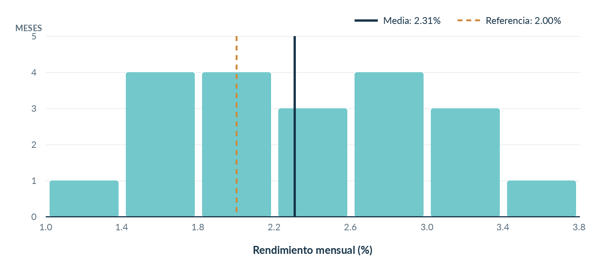

# Proyecto 01 | Estadística descriptiva de rendimientos

En este primer ejercicio analicé los rendimientos mensuales de un portafolio de inversión utilizando **20 observaciones** del laboratorio de Análisis Estadístico y Simulación.

El objetivo fue responder una pregunta sencilla: **¿cómo se comportaron los rendimientos y qué tan variables fueron?**

## ¿Qué hice?

Con R calculé la media, mediana, desviación estándar, cuartiles y rango. También preparé un histograma y un diagrama de caja para visualizar la distribución.

## ¿Qué encontré?

- El rendimiento promedio fue de **2.31% mensual**, frente a una referencia histórica de **2.00%**.
- Los rendimientos estuvieron entre **1.20% y 3.40%**.
- La desviación estándar muestral fue de **0.65 puntos porcentuales**.
- En **12 de los 20 meses** el rendimiento superó el 2.00%.

Para mí, lo interesante de este ejercicio es que un promedio por sí solo no cuenta toda la historia. También es necesario revisar la variación de los resultados antes de sacar conclusiones.

**Importante:** es un ejercicio académico con los datos originales del enunciado. Este análisis es descriptivo; no comprueba que el rendimiento poblacional sea superior a la referencia ni representa una recomendación de inversión.

## Archivos

- [`analisis.R`](analisis.R): código del análisis y generación de gráficos.
- [`practica-resuelta.pdf`](practica-resuelta.pdf): desarrollo breve, resultados e interpretación.
- [`figuras/`](figuras/): gráficos del análisis.

Para reproducirlo, abre esta carpeta en RStudio y ejecuta `source("analisis.R")`. Solo se necesita **R base**.
