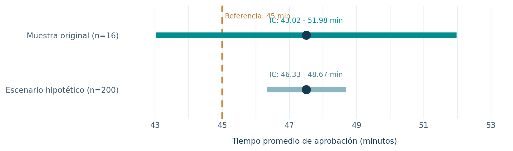

# Proyecto 02 | Intervalos de confianza en créditos digitales

En este ejercicio trabajé con una pregunta muy concreta: **¿podemos afirmar que la aprobación de un crédito digital tarda, en promedio, más o menos de 45 minutos?**

El enunciado académico presenta una muestra de **16 solicitudes**, con un tiempo promedio de **47.5 minutos** y una desviación estándar de **8.4 minutos**. Solo tenemos estos estadísticos resumidos; no se proporcionaron los tiempos individuales.

## ¿Qué hice?

Utilicé **R** para construir un intervalo de confianza del 95% con la distribución *t* de Student y contrastar una hipótesis bilateral frente a la referencia de 45 minutos. También comparé el resultado con un escenario hipotético de muestra más grande.

## ¿Qué encontré?

- **IC del 95%:** 43.02 a 51.98 minutos.
- **Prueba t bilateral:** t(15) = 1.19, valor p = 0.2524.
- **Conclusión:** con estos 16 casos, no hay evidencia suficiente para afirmar que el tiempo medio poblacional sea diferente de 45 minutos (α = 0.05).
- **Escenario hipotético:** si mantuviéramos media y desviación estándar, pero tuviéramos n = 200, el intervalo sería más estrecho: 46.33 a 48.67 minutos. No corresponde a observaciones nuevas.

Lo más interesante para mí es que una media muestral de 47.5 minutos no basta para asegurar que el proceso se alejó de la referencia. También importan la variabilidad, el tamaño de muestra y la incertidumbre de la estimación.

## Archivos

- [`analisis.R`](analisis.R): cálculos, prueba de hipótesis y gráfico reproducible en **R base**.
- [`practica-resuelta.pdf`](practica-resuelta.pdf): desarrollo e interpretación resumidos.
- [`figuras/intervalos-confianza.png`](figuras/intervalos-confianza.png): visualización de los intervalos.

Para reproducirlo, abre esta carpeta en RStudio y ejecuta `source("analisis.R")`.

*Nota:* es un ejercicio académico con los estadísticos originales. Como no contamos con los 16 tiempos individuales, no podemos verificar con los datos la normalidad o posibles valores atípicos; la inferencia supone observaciones independientes y una distribución aproximadamente normal en esta muestra pequeña.
