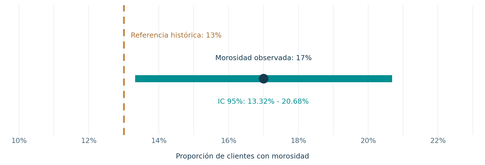

# Proyecto 03 | ¿La morosidad supera el 13 %?

En este ejercicio utilicé **R** para analizar una pregunta que puede surgir al evaluar una cartera de préstamos: **¿la proporción de clientes con morosidad supera una referencia del 13 %?**

El caso académico presenta **400 clientes**, de los cuales **68 estaban en morosidad**. Se conserva la información original del laboratorio.

## ¿Qué hice?

Calculé la proporción observada, construí un intervalo de confianza del 95 % y realicé una **prueba de hipótesis unilateral para una proporción**. También incluí una comprobación con la prueba binomial exacta y un ejercicio de *Bootstrap* con 1,000 remuestras.

## ¿Qué encontré?

- **Morosidad observada:** 17 % (68 de 400 clientes).
- **Referencia:** 13 %; diferencia observada de **4 puntos porcentuales**.
- **Intervalo de confianza clásico del 95 %:** 13.32 % a 20.68 %.
- **Prueba z unilateral:** z = 2.3788, **valor p = 0.0087**.

Con un nivel de significancia del 5 %, los datos ofrecen evidencia estadística de que la morosidad poblacional **supera el 13 %**, siempre que la muestra sea representativa y las observaciones sean independientes.

Lo que me deja este ejercicio es que observar un porcentaje mayor que la referencia no basta: también debemos evaluar la incertidumbre antes de sacar conclusiones. En una situación real, complementaría el análisis con la evolución de la cartera, los segmentos y los criterios de riesgo de la institución.

## Archivos y ejecución

- [`analisis.R`](analisis.R): análisis reproducible en **R base** (sin paquetes externos), incluye el ejercicio de Bootstrap y genera el gráfico.
- [`practica-resuelta.pdf`](practica-resuelta.pdf): procedimiento, resultados y conclusiones.
- [`figuras/intervalo-proporcion.png`](figuras/intervalo-proporcion.png): visualización del intervalo de confianza.

Abre la carpeta `03-hipotesis-proporcion` en RStudio y ejecuta `source("analisis.R")`.

**Alcance:** ejercicio académico; los datos no corresponden a una cartera real. La referencia del 13 % es un criterio proporcionado en el enunciado, no un límite regulatorio. La prueba indica evidencia estadística, no determina por sí sola medidas de gestión.
