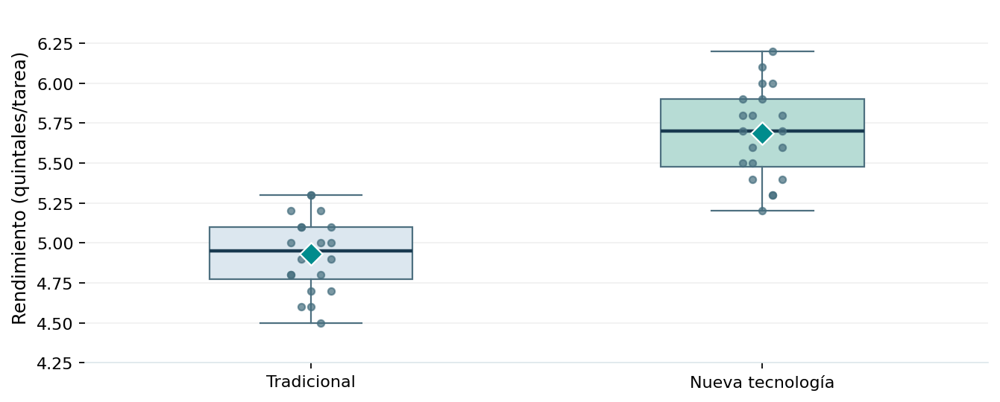

# Proyecto 04 | Comparación de dos medias

En este ejercicio quise responder una pregunta sencilla: **¿una nueva tecnología agrícola presenta un mejor rendimiento que el método tradicional?**

Utilicé los datos originales de una práctica de *Análisis Estadístico y Simulación*: dos grupos independientes de **20 productores**, con rendimientos medidos en **quintales por tarea**.

## ¿Qué hice?

Primero comparé los promedios y la variabilidad de ambos grupos. Después utilicé una **prueba t de Welch**, un **intervalo de confianza del 95 %** y **Bootstrap con 1,000 remuestras**. Todo está desarrollado en R base, sin paquetes adicionales.

## ¿Qué encontré?

| Resultado | Tradicional | Nueva tecnología |
| --- | ---: | ---: |
| Productores | 20 | 20 |
| Rendimiento promedio | 4.930 | 5.685 |
| Desviación estándar | 0.239 | 0.285 |

La nueva tecnología presentó un rendimiento promedio **0.755 quintales por tarea más alto**, aproximadamente **15.3 %** por encima del promedio tradicional.

- **IC clásico del 95 % para la diferencia:** 0.586 a 0.924 quintales por tarea.
- **Prueba unilateral de Welch:** valor p < 0.001.
- El ejercicio de **Bootstrap** permite comparar este resultado con un intervalo obtenido mediante remuestreo. Los límites exactos aparecen al ejecutar el script con la semilla indicada.

La evidencia estadística favorece un rendimiento promedio mayor en el grupo de la nueva tecnología. Eso no demuestra, por sí solo, que el cambio tecnológico sea la causa: para afirmarlo necesitaríamos conocer cómo se asignaron los productores y qué otras diferencias existían entre ellos.

## Archivos

- [`analisis.R`](analisis.R): código sencillo con los cálculos, la prueba t, Bootstrap y gráficos.
- [`practica-resuelta.pdf`](practica-resuelta.pdf): explicación del procedimiento y los resultados.
- [`figuras/comparacion-rendimientos.png`](figuras/comparacion-rendimientos.png): comparación visual.
- [`figuras/bootstrap-diferencias.png`](figuras/bootstrap-diferencias.png): distribución ilustrativa del remuestreo.

**Para ejecutarlo:** abre esta carpeta como proyecto de RStudio y corre `source("analisis.R")`. El script creará o actualizará los gráficos de `figuras/`.

**Nota:** estos datos son de un ejercicio académico, no de una evaluación real de campo. La figura del Bootstrap incluida es ilustrativa: se calculó con una simulación independiente; al ejecutar R se genera la figura correspondiente a la semilla del script.
