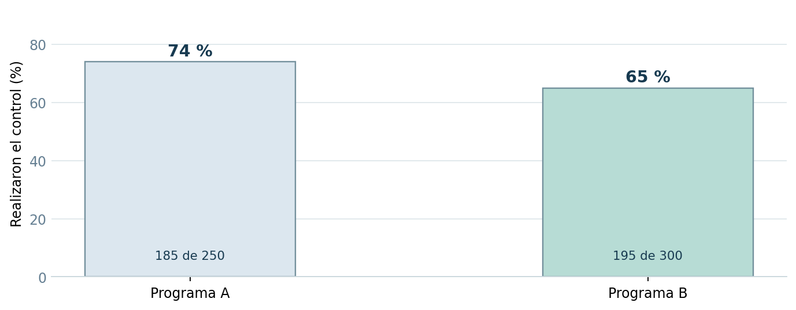
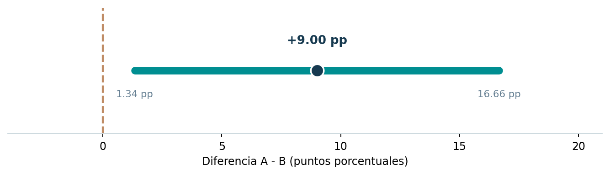

# Proyecto 05 | Comparación de dos proporciones

En este ejercicio quise responder una pregunta: **¿dos programas de salud preventiva presentan el mismo porcentaje de cumplimiento?**

Tomé los datos originales de una práctica de *Análisis Estadístico y Simulación*. En el **programa A**, 185 de 250 participantes realizaron su control anual; en el **programa B**, fueron 195 de 300.

## ¿Qué hice?

Calculé los porcentajes de ambos grupos, estimé un **intervalo de confianza del 95 % para la diferencia** y realicé una **prueba de hipótesis bilateral** para dos proporciones. El código utiliza R base, con `prop.test()` sin corrección de continuidad.

## ¿Qué encontré?

| Resultado | Programa A | Programa B |
| --- | ---: | ---: |
| Participantes | 250 | 300 |
| Realizaron el control | 185 | 195 |
| Cumplimiento | **74 %** | **65 %** |

La diferencia observada fue de **9 puntos porcentuales a favor del programa A**.

- **IC del 95 % de A - B:** 1.34 a 16.66 puntos porcentuales (aproximación normal).
- **Prueba bilateral de dos proporciones:** valor p = **0.0230**.
- **Decisión al 5 %:** hay evidencia estadística de una diferencia entre las proporciones poblacionales.

Para mí, el punto importante es que una diferencia de porcentajes debe analizarse considerando también el tamaño de las muestras y la incertidumbre. Además, que el resultado sea estadísticamente significativo no demuestra por sí solo que el programa A *causó* un mayor cumplimiento. Para recomendar una estrategia habría que revisar costos, accesibilidad y cómo se seleccionaron los participantes.

## Archivos y ejecución

- [`analisis.R`](analisis.R): código sencillo para los porcentajes, el intervalo, la prueba y los gráficos.
- [`practica-resuelta.pdf`](practica-resuelta.pdf): explicación del ejercicio y las conclusiones.
- [`figuras/`](figuras/): gráficos del análisis.

Para reproducirlo, abre esta carpeta en **RStudio** y ejecuta `source("analisis.R")`. No necesitas instalar paquetes.

*Nota: es un ejercicio académico con datos del enunciado, no un estudio clínico real. El intervalo utilizado es la aproximación normal clásica; requiere muestras independientes y suficientes observaciones por grupo.*
