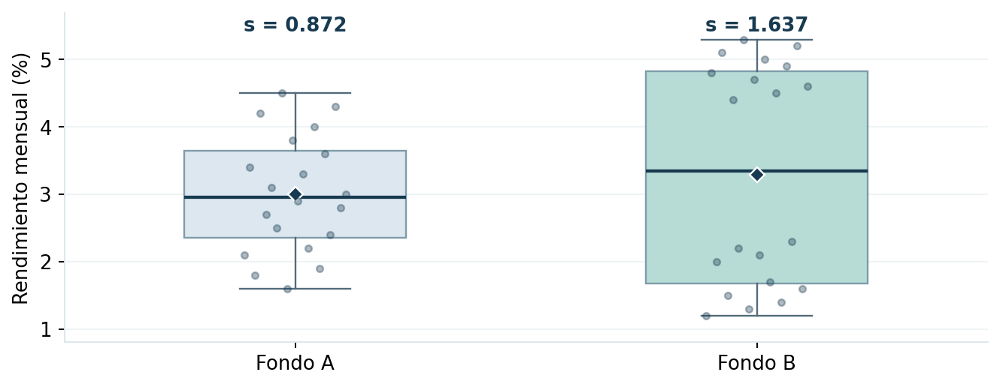
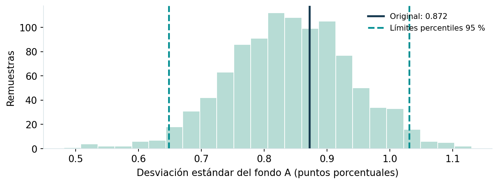

# Proyecto 06 | ¿Qué fondo de inversión presenta mayor volatilidad?

En este ejercicio quise comparar los rendimientos de dos fondos de inversión para entender **cuál varía más de un mes a otro**. Utilicé las 20 observaciones de cada fondo incluidas en una práctica de *Análisis Estadístico y Simulación*.

## ¿Qué hice?

Primero calculé la media, la desviación estándar y la varianza de cada fondo. Luego construí un **intervalo de confianza del 95 % para la desviación estándar del fondo A**, usando chi-cuadrado y un ejercicio de **Bootstrap con 1,000 remuestras**. Finalmente, comparé las varianzas con una prueba F.

Todo el código está en **R base**, sin paquetes adicionales.

## ¿Qué encontré?

| Indicador | Fondo A | Fondo B |
| --- | ---: | ---: |
| Observaciones | 20 | 20 |
| Rendimiento promedio mensual | 3.005 % | 3.290 % |
| Desviación estándar | 0.872 pp | 1.637 pp |
| Varianza | 0.7605 | 2.6788 |

El **fondo B presentó una volatilidad mayor**. Su varianza muestral fue aproximadamente **3.52 veces** la del fondo A.

- **IC clásico del 95 % para la desviación estándar del fondo A:** 0.663 a 1.274 puntos porcentuales.
- **Prueba F bilateral:** valor p = 0.0086, bajo el supuesto de normalidad.
- También utilicé **Bootstrap** para estimar un intervalo percentil de la desviación estándar del fondo A. El resultado reproducible aparece al ejecutar `analisis.R`.

**Un detalle importante:** al revisar la normalidad, el fondo B mostró una desviación importante (Shapiro-Wilk, p ≈ 0.0012). Por eso, **la conclusión de la prueba F clásica debe tomarse con cautela**. Agregué una comprobación con Fligner-Killeen, una alternativa más robusta frente a la falta de normalidad, que también respalda una diferencia de dispersión en estos datos.

## Archivos y ejecución

- [`analisis.R`](analisis.R): código y cálculos estadísticos, con los gráficos.
- [`practica-resuelta.pdf`](practica-resuelta.pdf): explicación de la práctica y sus principales resultados.
- [`figuras/`](figuras/): visualizaciones del análisis.
- [`post-linkedin.md`](post-linkedin.md): texto propuesto para compartir el proyecto.

Para ejecutarlo, abre **esta carpeta** como directorio de trabajo en RStudio y usa `source("analisis.R")`. El script crea las imágenes en la carpeta `figuras/`.

> **Nota:** es un ejercicio académico, no una evaluación de fondos reales. Los gráficos incluidos se prepararon con los mismos datos; la figura de Bootstrap muestra una simulación independiente de 1,000 remuestras, por lo que sus límites pueden variar ligeramente respecto de los producidos por la semilla de R.
