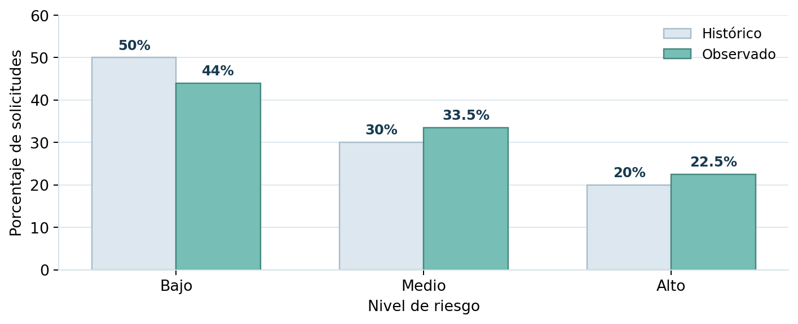
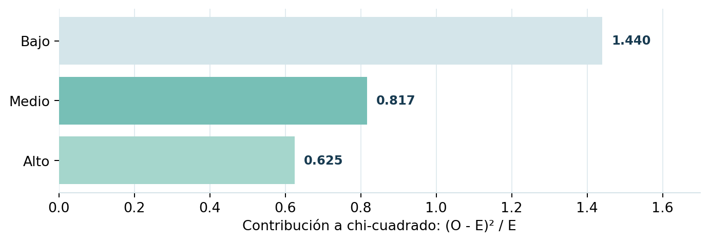

# Proyecto 07 | ¿Cambió la distribución del riesgo crediticio?

En este ejercicio utilicé una **prueba chi-cuadrado de bondad de ajuste** para revisar si la clasificación de riesgo de una cartera de solicitudes de crédito es consistente con las proporciones históricas.

Es un caso académico de la asignatura *Análisis Estadístico y Simulación*. Conservé los datos del ejercicio y realicé los cálculos en **R base**.

## Datos del problema

Se analizaron 200 solicitudes, clasificadas en tres niveles de riesgo:

| Nivel de riesgo | Proporción histórica | Casos observados | Proporción observada |
| --- | ---: | ---: | ---: |
| Bajo | 50 % | 88 | 44 % |
| Medio | 30 % | 67 | 33.5 % |
| Alto | 20 % | 45 | 22.5 % |

## ¿Qué hice?

Calculé las frecuencias esperadas, apliqué `chisq.test()` y revisé cuánto aporta cada categoría al estadístico. La hipótesis nula plantea que la distribución poblacional mantiene las proporciones **50 %, 30 % y 20 %**.

## ¿Qué encontré?

- Frecuencias esperadas: **100, 60 y 40** solicitudes.
- Estadístico chi-cuadrado: **2.8817**, con **2 grados de libertad**.
- Valor p: **0.2367**.

Como el valor p supera 0.05, **no encontré evidencia estadística suficiente para afirmar que la distribución cambió**. Esto no quiere decir que se haya demostrado que las proporciones son exactamente iguales.

El nivel de riesgo bajo fue el que más aportó al estadístico de la prueba, porque registró 88 solicitudes frente a las 100 esperadas.

## Archivos del proyecto

- [`analisis.R`](analisis.R): datos, prueba estadística y gráfico en R.
- [`practica-resuelta.pdf`](practica-resuelta.pdf): procedimiento e interpretación.
- [`figuras/`](figuras/): gráficos.

> Los datos son de una práctica académica, no de una cartera bancaria real. La prueba supone observaciones independientes y frecuencias esperadas suficientemente grandes; ambas cuestiones deben revisarse al aplicar el método en la práctica.
