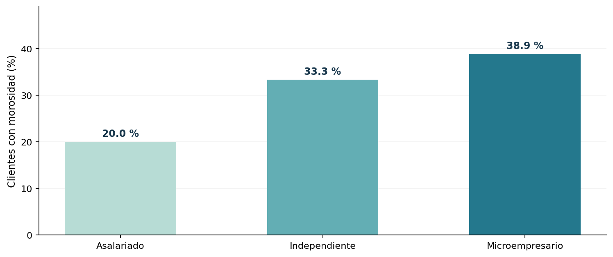

# Proyecto 08 | ¿Existe relación entre el tipo de cliente y la morosidad?

Quise revisar si la morosidad cambia según el tipo de cliente. Para eso tomé una tabla académica con 360 clientes y apliqué una prueba chi-cuadrado de independencia.

Este es un **ejercicio académico** de Análisis Estadístico y Simulación. Conservo los datos originales y utilizo R base para resolverlo.

## ¿Qué hice?

Organicé los conteos en una tabla de contingencia, calculé las frecuencias esperadas y apliqué una prueba chi-cuadrado de independencia. H0: el tipo de cliente y la morosidad son independientes. H1: existe asociación entre ambas variables.

## Principales resultados

Encontré una asociación estadísticamente significativa (χ² = 11.2269, p = 0.0036). La tasa observada fue de 20.0 % en asalariados, 33.3 % en independientes y 38.9 % en microempresarios. Esto no demuestra una relación causal.

**Lo que tendría en cuenta:** Una asociación no significa que el tipo de cliente cause la morosidad. Para comprender esa relación también revisaría ingresos, endeudamiento, antigüedad crediticia y características del préstamo. La prueba global tampoco establece qué pares de grupos difieren.

## Archivos

- [`analisis.R`](analisis.R): script con los datos y los cálculos.
- [`practica-resuelta.pdf`](practica-resuelta.pdf): análisis breve con interpretación.
- [`figuras/`](figuras/): gráficos de apoyo.
