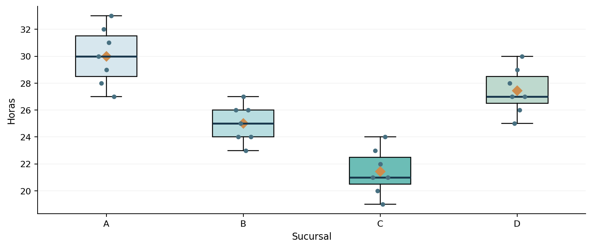

# Proyecto 09 | ¿Aprueban los créditos igual de rápido en todas las sucursales?

En este problema comparé cuánto tardan cuatro sucursales en aprobar préstamos. La idea era comprobar si las diferencias que se ven en los promedios también cuentan con evidencia estadística.

Este es un **ejercicio académico** de Análisis Estadístico y Simulación. Conservo los datos originales y utilizo R base para resolverlo.

## ¿Qué hice?

Calculé promedios y dispersión, visualicé los grupos con boxplots y apliqué ANOVA de un factor. H0: las cuatro medias poblacionales son iguales. H1: al menos una media es diferente. Complementé con Shapiro-Wilk, Bartlett y Tukey para localizar diferencias.

## Principales resultados

El ANOVA dio F = 29.6477 y p = 3.06e-08. La sucursal C tuvo el menor promedio (21.43 horas) y Tukey mostró diferencias significativas respecto de A, B y D. Esto no significa que aprobar más rápido equivalga siempre a mejor calidad.

**Lo que tendría en cuenta:** La sucursal que aprueba más rápido no es automáticamente la mejor. Haría falta comparar calidad de evaluación, complejidad de las solicitudes, morosidad posterior y satisfacción de clientes. La independencia depende del diseño de muestreo.

## Archivos

- [`analisis.R`](analisis.R): script con los datos y los cálculos.
- [`practica-resuelta.pdf`](practica-resuelta.pdf): análisis breve con interpretación.
- [`figuras/`](figuras/): gráficos de apoyo.
