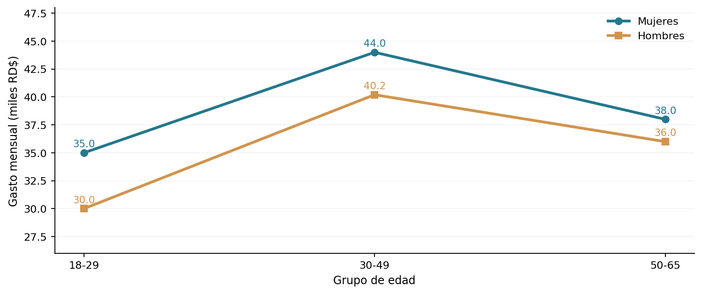

# Proyecto 10 | Gasto con tarjeta: edad, género e interacción

En este ejercicio quise ver si el gasto mensual con tarjeta se relaciona con dos variables a la vez: edad y género. El objetivo fue entender también qué significa una interacción entre factores.

Este es un **ejercicio académico** de Análisis Estadístico y Simulación. Conservo los datos originales y utilizo R base para resolverlo.

## ¿Qué hice?

Calculé las medias de las seis combinaciones y elaboré un gráfico de interacción. Después ajusté un ANOVA de dos factores con interacción (gasto ~ edad * género). Primero evalué la interacción; luego interpreté los efectos principales.

## Principales resultados

La interacción no fue estadísticamente significativa (p = 0.1823), pero sí encontramos diferencias en las medias por edad y género. El grupo de 30 a 49 años presentó los mayores promedios muestrales. Son asociaciones, no efectos causales demostrados.

**Lo que tendría en cuenta:** No atribuiría las diferencias al género o a la edad como causas aisladas. Podrían intervenir ingresos, límites de crédito, hábitos de consumo y selección de los clientes. Si la interacción hubiese sido significativa, habría que analizar cada combinación por separado.

## Archivos

- [`analisis.R`](analisis.R): script con los datos y los cálculos.
- [`practica-resuelta.pdf`](practica-resuelta.pdf): análisis breve con interpretación.
- [`figuras/`](figuras/): gráficos de apoyo.
