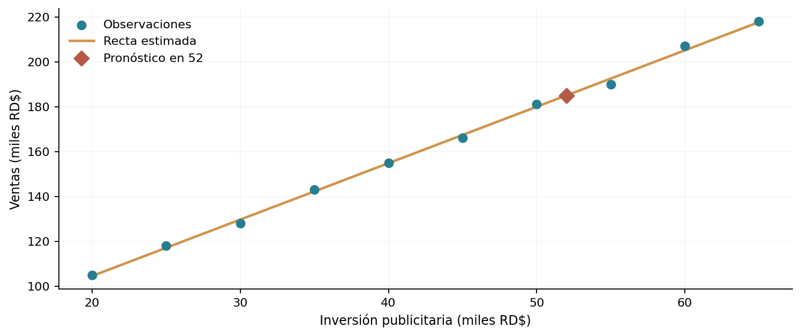

# Proyecto 11 | Inversión publicitaria y ventas: regresión lineal

Quise ver cómo se puede usar una regresión lineal sencilla para describir la relación entre la inversión publicitaria y las ventas de una empresa.

Este es un **ejercicio académico** de Análisis Estadístico y Simulación. Conservo los datos originales y utilizo R base para resolverlo.

## ¿Qué hice?

Representé los datos en un diagrama de dispersión y ajusté el modelo con lm(ventas ~ inversion). Revisé la pendiente, el coeficiente R² y generé un pronóstico de las ventas cuando la inversión semanal es de 52 mil pesos.

## Principales resultados

La pendiente fue 2.5152, con R² = 0.9987. Para una inversión de 52 mil pesos, el modelo estima ventas por 184.99 mil pesos. Es una asociación observada, no una prueba de causalidad.

**Lo que tendría en cuenta:** Un R² tan alto no demuestra que la publicidad cause las ventas. Pueden influir temporada, demanda, promociones u otras decisiones. El ajuste de un caso académico tampoco garantiza el mismo desempeño con nuevos datos o inversiones fuera del rango analizado.

## Archivos

- [`analisis.R`](analisis.R): script con los datos y los cálculos.
- [`practica-resuelta.pdf`](practica-resuelta.pdf): análisis breve con interpretación.
- [`figuras/`](figuras/): gráficos de apoyo.
