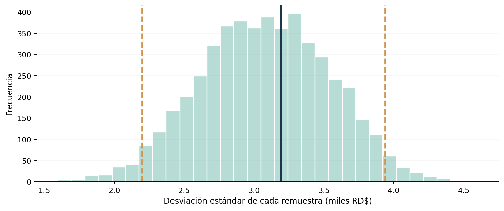

# Proyecto 12 | Bootstrap para estimar montos de transacciones

En este ejercicio exploré cómo aplicar Bootstrap a montos de transacciones financieras. Mi idea fue comparar un intervalo de confianza tradicional con otros construidos mediante remuestreo.

Este es un **ejercicio académico** de Análisis Estadístico y Simulación. Conservo los datos originales y utilizo R base para resolverlo.

## ¿Qué hice?

Primero calculé la media, la desviación estándar y el intervalo t clásico. Luego, con una semilla fija, tomé 5,000 remuestras de tamaño 20 con reemplazo. En cada una calculé la media y la desviación estándar, y construí intervalos con los percentiles 2.5 y 97.5.

## Principales resultados

La media observada fue 17.425 mil pesos. El IC clásico del 95 % fue [15.93, 18.92]; el intervalo Bootstrap percentil reportado en la práctica fue [16.10, 18.85]. Para la desviación estándar, el intervalo Bootstrap reportado fue [2.18, 3.94]. Los resultados exactos del remuestreo se calculan al ejecutar R.

**Lo que tendría en cuenta:** Bootstrap no corrige una muestra sesgada ni la dependencia entre observaciones. Tampoco crea más información: repetir el remuestreo mejora la estabilidad de la simulación, pero la muestra original sigue siendo de 20 valores. Los percentiles pueden variar según la semilla y el generador.

## Archivos

- [`analisis.R`](analisis.R): script con los datos y los cálculos.
- [`practica-resuelta.pdf`](practica-resuelta.pdf): análisis breve con interpretación.
- [`figuras/`](figuras/): gráficos de apoyo.
